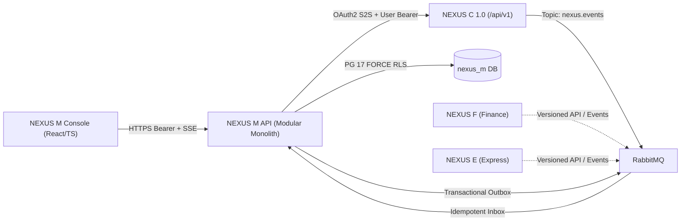

# NEXUS M — Integration Architecture

**Status:** Phase 1 Architecture Freeze  
**Last Updated:** 2026-11-27

## 1. Integration Topology

## 2. Outbound NEXUS C Client Resilience Standards
All HTTP calls from NEXUS M to NEXUS C MUST use a typed `NexusCoreHttpClient` configured with:
- **Authentication:**
  - User-context calls (`/auth/permissions`, `/auth/organization-scope`, `/auth/authorize`, `/workflows/*`) forward the caller's validated `Authorization: Bearer <userJwt>`.
  - System/background calls (`/entitlements/*`, `/applications/*`, `/notifications/send`, `/files`, `/fx`) use a cached OAuth2 `client_credentials` token (`nexus-m-service`, refreshed 60s before expiry).
- **Headers:** Always propagate `X-Correlation-Id`, W3C `traceparent`, and `Idempotency-Key` (on state-changing calls).
- **Resilience:** Explicit per-call timeout (default 5s for auth/entitlement, 15s for file/report calls), bounded retry with jitter ONLY on idempotent `GET` or `Idempotency-Key` requests, and circuit breaker that fails closed on security checks.

## 3. Inbound Data Ingestion (`M10` — Data & Integration Hub)
Every external or ecosystem data connector (NEXUS F, NEXUS E, third-party ERP/CRM) MUST declare:
1. **Contract Schema & Version:** Explicit JSON schema + `schemaVersion`.
2. **Idempotency Key:** Deterministic `(sourceApplication, sourceReferenceId, sourceDataVersion)` preventing duplicate observations.
3. **Freshness SLA:** Expected ingestion cadence; missed windows automatically transition metric freshness to `DELAYED` / `STALE` and emit an alert.
4. **Reconciliation Record:** Periodic count/checksum/total reconciliation comparing ingested read-model aggregates against source summary endpoints.
5. **Failure Handling:** Exponential backoff retries → Dead-Letter Queue (`m_integration.dead_letters`) → audited manual replay (capped at 3 manual retries per item without root-cause override).
